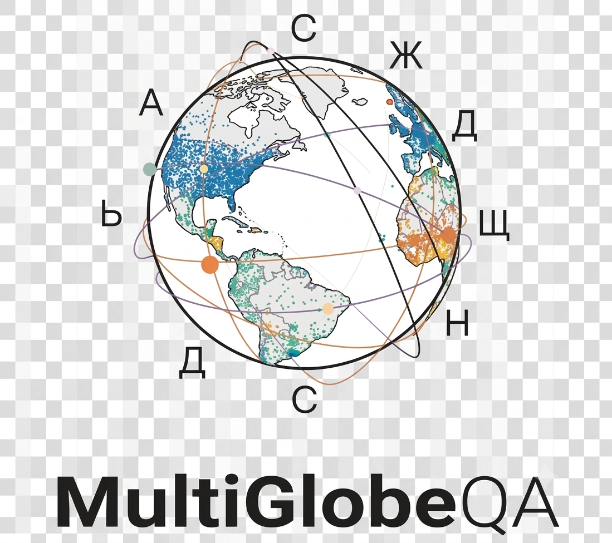

# MultiGlobeQA

<h1 align="center">
  
</h1>

A multilingual, globally distributed benchmark for execution-verified geospatial
reasoning, with the harness that runs models against it and the scorer that grades
them.

Every answer is computed from a knowledge graph by spatial SQL, so the ground truth is
verifiable and the questions can be regenerated.

| | |
|---|---:|
| questions per language (`large`) | 46,060 |
| questions per language (`small`) | 5,916 |
| languages | 17 |
| parent templates / sub-templates / paraphrase variants | 65 / 129 / 315 |
| spatial-function families | 14 |
| answer types | 17 |
| knowledge graphs | 3 |

`small` is a subset of `large` with the same identifiers, sampled per
(KG, spatial function, template, stratum, premise) cell.

## Getting the data

The benchmark is published separately, on HuggingFace:

```python
from datasets import load_dataset

questions = load_dataset("aiana94/MultiGlobeQA", "eng", split="large")
gold      = load_dataset("aiana94/MultiGlobeQA", "gold_triples", split="large")
```

It also carries the per-language alias stores, which the scorer takes as a required
argument. The multimodal slice ships image URLs rather than image bytes.

The knowledge-graph snapshots the questions were generated from are archived on
Zenodo: <https://doi.org/10.5281/zenodo.21786184>. They are needed for tier-3 retrieval and for
regenerating the questions, and for nothing else.

## Install

```bash
uv sync --extra models --extra dev      # run models and score
uv sync --extra kg                      # adds tier-3 knowledge-graph retrieval
uv sync --extra generate                # adds question generation
```

Scoring and tier-1/2 inference need neither Spark nor a knowledge graph. Tier-3
retrieval reads the KG Delta tables through Spark, so it needs the `kg` extra and a
local copy of the graphs from Zenodo (<https://doi.org/10.5281/zenodo.21786184>).

## Run a model

```bash
python -m benchmark_models smoke --variant dummy --n 10
```

`dummy` returns canned predictions and needs no GPU or API key. For a real model, pick
a variant from `benchmark_models/models.yaml` and set the backend's credentials
(`GOOGLE_API_KEY` for Gemini, `VLLM_BASE_URL` for a local `vllm serve`):

```bash
python -m benchmark_models smoke \
    --variant gemini-3-flash-plain \
    --benchmark <data>/large/ --language deu --n 100
```

One process per language; `--language` filters the shard walker. Wrapper instructions
stay in English and only the question text is translated.

## Score predictions

```bash
python -m benchmark_eval score \
    --predictions results/.../predictions.jsonl \
    --benchmark   <data>/small/ \
    --aliases     <data>/aliases/eng.json \
    --output      results/.../scores/
```

Writes `score_records.jsonl` (one row per question) and `aggregate_report.json`.
Predictions join gold by `question_id`.

## Evaluation tiers

| tier | what the model gets |
|---|---|
| 1 | the question alone |
| 2 | the question, with reasoning enabled |
| 3a | KG retrieval tools and a Python executor |
| 3b | web search |
| 3c | both |
| oracle | the gold triples injected in place of retrieval |

Tier 3 runs as a code agent: the model calls retrieval and computation tools in a loop
and returns a final answer.

## Metrics

`benchmark_eval` scores each answer by its type, with per-type tolerances declared in
`benchmark_eval/scoring_spec.json`:

- **EM** — exact match under that type's tolerance.
- **NE** — normalized error, so a near miss and a large one are distinguishable.
- **coverage** — the share of questions that produced a parseable answer. A question is
  uncovered if the model abstained, emitted an unparseable answer, or the harness
  errored.
- **negative rejection / false refusal** — on false-premise questions, whether the model
  correctly declined; on answerable ones, whether it wrongly did.

Questions carry `is_true_premise`. False-premise questions have no valid answer and are
scored on abstention rather than on EM.

## Layout

| path | contents |
|---|---|
| `benchmark_models/` | inference harness: tiers, backends, KG tools, oracle injection |
| `benchmark_eval/` | scorer, per-type tolerances, alias resolution, aggregation |
| `question_generator/` | question generation: SQL shapes, sampling, validation, export |
| `data_extraction/` | knowledge-graph construction from source dumps |
| `pipelines/translation/` | machine translation of the template variants |
| `pipelines/postedit/` | LLM ensemble post-editing of the translations |
| `data/templates/` | the 315 variants, one TSV per language, joined by `vid` |
| `data/reference/` | country polygons and World Bank income groups |
| `config/kg_prefixes.yaml` | per-KG predicate IRIs by role |
| `scripts/` | scoring drivers |
| `nt_parser_rs/` | Rust N-Triples parser used by the KG build |

## Templates

A question's identity is a three-level id. Parent template `13` states the operation;
sub-template `13.1` fixes the operands; variant `13.1.2` is one paraphrase of it. Rows
carry all three as `tid`, `ftid` and `vid`.

`data/templates/templates_<lang>.tsv` holds all 315 variants for one language, keyed by
`vid`, so the 17 files join on their identifier columns. Only the variant is
translated; the `template_eng` and `sub_template_eng` columns are English in every file.

The spatial families are lettered A–N and defined in
`benchmark_models/schemas/spatial_functions.py`. Coverage varies by graph: not every
family can be asked of every KG.

## Regenerating the questions

Generation reads a run spec plus the per-sub-template SQL under
`question_generator/sql_shapes/<sfid>/<tid>.{meta.yaml,sql,gold.sql}`:

```bash
multiglobeqa generate --run <spec>.yaml
```

`RunSpec` in `question_generator/shape_loader.py` defines the spec: the sub-templates
(`tids`, each optionally `<tid>:<variant>`), the graphs (`kgs`), the strata, a seed, a
sample size and an output directory. No spec is shipped, and generation also needs a
Spark cluster and local copies of the knowledge graphs (<https://doi.org/10.5281/zenodo.21786184>).

## Tests

```bash
uv run pytest tests/
```

Covers the scorer and the harness. The generator and KG-ingest suites are not included;
they need Spark fixtures that are not part of this repository.

## Licence

MIT, see [LICENSE](LICENSE). The knowledge graphs the questions derive from carry their
own licences.

## Citation

If you use MultiGlobeQA, please cite the following publication:

```
@misc{boeckling2026multiglobeqa,
  title={MultiGlobeQA: A Multilingual and Globally Diverse Benchmark for Geospatial Reasoning},
  author={Martin Böckling and Elizaveta Nosova and Heiko Paulheim and Andreea Iana},
  year={2026},
  eprint={2608.03882},
  archivePrefix={arXiv},
  primaryClass={cs.CL},
  url={https://arxiv.org/abs/2608.03882}, 
}
```

